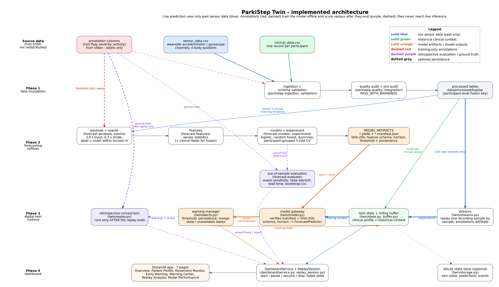

# ParkiStep Twin: A Patient-Specific Digital Twin for Freezing-of-Gait Forecasting in Parkinson's Disease

> **Research prototype. Not a medical device.** ParkiStep produces experimental model scores, not diagnoses or validated
> clinical instructions. Its measured out-of-sample performance is weak and variable (see [Model and evaluation](#12-model-and-evaluation)
> and [Limitations](#13-limitations)). Nothing here shows that it prevents falls or improves any health outcome.

## 1. Project overview

**Freezing of gait (FoG)** is a sudden, temporary inability to step forward that affects many people with Parkinson's disease;
a person may feel their feet "glued" to the floor. It is a common cause of falls. It is hard to predict because episodes are
brief, irregular and strongly person- and task-dependent, and the minutes before one can look like ordinary walking.

**ParkiStep Twin** asks whether a short, rolling window of wearable-sensor data can estimate the chance that an episode *will
begin* within the next few seconds. It is organised as a **digital twin**: a software object per patient that

1. holds the patient's **historical clinical record** (context that changes slowly),
2. receives **wearable sensor observations one at a time** and keeps a bounded rolling buffer,
3. asks a trained forecasting model for a score when the buffer is valid,
4. applies a configurable **warning policy** to those scores, and
5. keeps an auditable history that a dashboard can display.

Clinical data and sensor streams are combined because they carry different information: the sensors describe the last few
seconds of movement; the clinical record describes the person. Whether the clinical record actually *helps* is one of the
questions the experiments tested (answer so far: the data cannot distinguish the two, see section 12).

## 2. Problem statement

For a recording, at each anchor time *t* the model sees only the trailing 2.0 s of sensor data (never the future) and outputs a
score for "an annotated FoG episode **starts** within the next *H* seconds" (*H* = 1, 3 or 5 s were evaluated).

This differs from **detecting** an episode already under way. Windows that contain or follow an ongoing episode are excluded
from training and evaluation by design, so the task is forecasting a *new onset*, scored against the annotated onset time.
Annotations come from video at 10 fps; recordings are structured laboratory tasks.

## 3. Healthcare use case

A clinician or researcher can open the dashboard, inspect a (virtual) patient's clinical profile, replay a real recorded
session as if it were arriving live, watch the movement signals, scores and warnings update, and afterwards compare what the
twin predicted with the actually annotated episodes. The aim is to make a research model's behaviour, including its failures,
inspectable. It is a research and demonstration tool, not a monitoring system.

## 4. Technical stack

From `requirements.txt` and the source: **Python ≥ 3.10** (developed and tested on 3.12), **pandas / NumPy / SciPy** (data and
signal features), **scikit-learn** (logistic regression and random-forest forecasters, participant-grouped cross-validation),
**joblib** (model files), **PyYAML** (all configuration), **pyarrow** (parquet tables; required in practice by the dashboard),
**Streamlit** and **Plotly** (dashboard), **SQLite** (optional twin-state persistence, Python standard library), **matplotlib**
(Phase 1 audit figures), **requests** (optional dataset download), **pytest** (tests). Optional, for verification scripts only:
**Playwright + Chromium** and **psutil** (`requirements-browser.txt`); **Graphviz** (rebuild the architecture diagram).

## 5. Architecture



Vector version: [`docs/phase6/architecture.pdf`](docs/phase6/architecture.pdf) · editable source:
[`docs/phase6/architecture_src/architecture.dot`](docs/phase6/architecture_src/architecture.dot).

*Caption.* Two data streams enter from FoG-STAR: static **clinical** records (green) and the dynamic **wearable** stream (blue).
Phase 1 validates, audits and fuses them at participant level. Offline (Phase 2), annotations (red, dashed) are used only to
build training labels and to evaluate out-of-fold predictions; this produces model artifacts with checksummed manifests. At run
time (Phase 3) the twin replays one recording sample by sample with annotations withheld, keeps a rolling buffer, calls the
model through a gateway that re-verifies the artifact, and a warning manager turns scores into warnings. The dashboard (Phase 4)
displays state and history; only after a replay ends does the retrospective comparison (purple, dashed) bring the annotations
back to score what happened. Future labels never enter live prediction.

## 6. Dataset and attribution

**FoG-STAR: Freezing of Gait Severity, Tasks, Activities, and Ratings**, https://zenodo.org/records/17838806, licence **CC BY 4.0**
(per `docs/DATASET_PROVENANCE.md`; version "3.0" as stated in the dataset's bundled README). Cite: Borzì, L. et al. (2026),
*Sci Data* 13, 305, https://doi.org/10.1038/s41597-026-06645-1.

**The dataset is not included in this repository.** You need two files, placed in `data/raw/fogstar/`:
`sensor_data.csv` and `clinical_data.csv`. Obtain them from the Zenodo record (download manually, or
`python scripts/acquire_data.py --download`; or `--from-archive path/to/Dataset.zip` for a local copy). `data/raw/`,
`data/interim/` and `data/processed/` are git-ignored. Processed tables and trained models are derivatives of the dataset;
credit the authors and indicate changes if you share them. See [`THIRD_PARTY_NOTICES.md`](THIRD_PARTY_NOTICES.md).

## 7. Installation

```bash
python -m venv .venv && source .venv/bin/activate        # Windows: .venv\Scripts\activate
pip install -r requirements-lock.txt                     # recommended: the exact versions the shipped models were trained/tested with
#   or: pip install -r requirements.txt                  # lower bounds only - newest releases (see note below)
pip install -r requirements-browser.txt                  # optional: browser/soak verification scripts
python -m playwright install chromium                    # optional: only with the line above
```

**Why the lock file.** With `requirements.txt` pip installs the newest releases. In the Phase 6 clean-environment test that
worked (all tests passed, the dashboard started), but scikit-learn 1.9.1 loaded the models trained with 1.8.0 and raised
`InconsistentVersionWarning` ("might lead to breaking code or invalid results"). `requirements-lock.txt` removes the warning, and
`python scripts/p6_verify_artifacts.py` reports any such version mismatch. If you must use newer versions, re-train with
`scripts/train_phase2.py`.

## 8. Configuration

Everything changeable is in YAML; no source edits are needed to change a dataset, model, horizon, threshold or recording.

| File | Controls |
|---|---|
| `configs/project.yaml`, `configs/datasets.yaml` | paths, column mappings, units, validation thresholds, label definitions (Phase 1) |
| `configs/phase2.yaml` | windowing, horizons, features, models, splits, threshold policy, alert policy |
| `configs/phase3.yaml` | twin engine: model selection (`model.experiment/model/horizon_s`), buffer, warning policy, persistence, replay selection |
| `configs/phase4.yaml` | dashboard: navigation, replay speed, plots, styles, texts, retention |

Override without editing files: `--set key=value` on every script (e.g. `--set model.experiment=fusion --set model.model=logistic
--set model.horizon_s=5.0`), or environment variables for the dashboard: `PARKISTEP_PHASE4_SET="replay.default_speed=10"` and
`PARKISTEP_PHASE3_SET="persistence.path=/tmp/state.sqlite"`. In the dashboard, patient, recording and model are chosen in
**Replay Analysis**; valid patient/recording combinations are discovered from the data at run time. Model identity, horizon,
input window, feature schema and operating threshold are read from each model's manifest, not from the configuration.

## 9. Running the project

```bash
# data
python scripts/acquire_data.py --download                 # or place the two CSV files in data/raw/fogstar/
python scripts/prepare_data.py                            # Phase 1: audit + reports + processed tables
python scripts/audit_data.py                              # audit and reports only
# Phase 2 forecasting inputs and models (training takes a while; trained artifacts are required by Phases 3-4)
python scripts/prepare_phase2_windows.py                  # events, windows, labels, features -> data/interim/phase2/
python scripts/train_phase2.py                            # grouped CV, thresholds, final models -> artifacts/phase2/<id>/
python scripts/evaluate_phase2.py                         # metrics + reports/phase2/
# model gate and digital twin
python scripts/verify_twin_model.py                       # file + SHA-256 + schema + one real prediction
python scripts/p6_verify_artifacts.py                     # every artifact found in the manifests, with negative-control-tested checksum check
python scripts/replay_twin.py                             # replay the configured real recording through the engine (writes reports/phase3/)
python scripts/create_twin.py --patient 3                 # create a persisted twin
python scripts/inspect_twin.py --list                     # inspect persisted twins
# dashboard
streamlit run app/Home.py
# tests (real data + trained artifacts must be present; REQUIRE_REAL turns silent skips into failures)
PARKISTEP_REQUIRE_REAL=1 python -m pytest -q -p no:cacheprovider
```

**Model artifacts.** Phases 3 and 4 need `artifacts/phase2/<experiment_id>/models/*.joblib` plus `*.manifest.json`. `artifacts/`
is git-ignored. If an artifact is missing or fails its SHA-256 check, the commands stop with an explanation and never substitute
another model. Either re-create them with the three Phase 2 commands above or obtain them from the project owner (see
`artifacts/README.md`) and verify with `scripts/p6_verify_artifacts.py`.

**Phase 6 verification scripts** (all write JSON to `reports/phase6/`): `p6_verify_artifacts.py`, `p6_recompute_metrics.py`
(independent recomputation of replay metrics), `p6_audit_recheck.py` (re-derives the Phase 1 warning facts from the raw CSVs),
`p6_repo_audit.py` (secrets/hygiene scan), `p6_soak.py` (resource test), and the browser scripts `p6_browser_failure_paths.py`,
`p6_browser_multi.py`, `p6_visual_review.py` (which launch `tests/fixtures/fault_app.py`, a test-only wrapper that injects
controlled faults and never touches data or models).

## 10. Demonstration workflow

1. `streamlit run app/Home.py` and open the printed URL.
2. **Replay Analysis**: choose a patient, one of that patient's recordings, a model and a speed, then press **Start**.
3. Watch **Overview**, **Movement Monitor** and **Early Warning** update; **Warning Center** lists raised warnings.
4. **Pause / Resume / Stop** at any time; navigating between pages does not interrupt a replay.
5. When the replay ends, the **retrospective analysis** appears: annotated events are shown for the first time, together with
   detections, false warnings and lead times, labelled in-sample.
6. **Patient Profile** shows the clinical record (missing values stay "not recorded"); **Model Performance** shows the saved
   participant-grouped Phase 2 results.

A full 20-minute demonstration script is in [`docs/phase6/DEMO_VIDEO_SCRIPT.md`](docs/phase6/DEMO_VIDEO_SCRIPT.md).

## 11. Documentation map

`docs/phase0/` requirements and original architecture · `docs/phase1_data_foundation.md`, `docs/DATASET_PROVENANCE.md`,
`docs/configuration.md` · `docs/phase2/` methodology, Phase 1 re-verification · `docs/phase3/` twin engine ·
`docs/phase4/` dashboard · `docs/phase5/` verification, performance, repairs · `docs/phase6/` final verification, release
checklist, manifest, architecture, presentation, demo script. Historical reports are preserved, not overwritten.

## 12. Model and evaluation

Source for every number below: [`reports/phase2/phase2_results_report.md`](reports/phase2/phase2_results_report.md)
(generated from saved out-of-fold predictions; experiment `fog_onset_forecast_6499e95d`).

* **Data:** 22 participants, 101 annotated events (75 evaluable after sensor-quality filtering), roughly one hour of scored
  monitoring time in total.
* **Design:** 2.0 s input window, 0.2 s anchor stride, horizons 1/3/5 s. **Participant-grouped** 5-fold cross-validation
  (no participant appears in both training and test folds). The operating threshold is chosen on training participants only
  with a false-alert budget of 30 alerts/hour. Event sensitivity, false alerts per hour and lead time are computed per annotated
  event; 95 % intervals come from 300 participant bootstrap resamples.
* **Default dashboard model** (`sensor_only` random forest, 3 s horizon): average precision 0.134 (prevalence 0.062), ROC-AUC 0.704,
  event sensitivity **0.21 (16/75; 95 % CI 0.04-0.35)**, **74.3 false alerts/hour (CI 24.2-123.9)**, median warning lead 1.65 s.
  The realised false-alert rate is well above the 30/h budget used to pick the threshold: the threshold did not transfer to
  held-out participants.
* **Across all models and horizons** event sensitivity is 0-0.21 and false alerts are frequent or sensitivity is near zero;
  where a model detected any event its median warning lead time was 0.6-3.3 s.
* **Clinical + sensor fusion vs sensor-only:** the paired participant-bootstrap verdict on average precision is "no distinguishable
  difference" for every model and horizon; the data **do not distinguish** the two (there are only 22 clinical profiles to learn from).
* **In-sample vs out-of-sample:** the saved final models were fitted on *all* participants. A dashboard replay of a dataset
  recording is therefore an **in-sample software demonstration**, not evidence of predictive performance. The out-of-sample
  reference is the participant-grouped Phase 2 report above.

## 13. Limitations

* **Small cohort:** 22 participants; windows from one person are strongly correlated; intervals are wide and fold results unstable.
* **Controlled recordings:** structured laboratory tasks, not free-living monitoring; annotations are accurate to the 10 fps video.
* **Weak, variable out-of-sample sensitivity** and **high false-alert frequency** (above).
* **Uncalibrated scores:** outputs are not probabilities of a freezing episode; the dashboard labels them as uncalibrated scores.
* **Some recordings yield no forecast** (for example, replaying `p22-s1-t4` produced no forecast: 277 windows were rejected as
  insufficient sensor quality); the dashboard reports this instead of showing a score.
* **No clinical validation** and no evidence of real-world effectiveness; the experiment cannot establish either.
* **Persistence mode** (`replay.persist_state=true`) is optional and off by default; a persisted twin is never overwritten, so
  replaying the same patient twice requires another store path.

## 14. Safety statement

ParkiStep Twin produces experimental research outputs. A "warning" is the result of a configurable policy applied to an
uncalibrated model score; it does not establish that a freezing episode is occurring or will occur, and the absence of a warning
does not mean none will. Do not use it for diagnosis, treatment decisions, fall prevention or any safety-critical purpose.

## 15. Verification status of this release

Verified results are recorded in `reports/phase6/` and summarised in `docs/phase6/PHASE5_FINAL_VERIFICATION.md` and
`docs/phase6/PHASE6_COMPLETION_REPORT.md`; the machine-readable record is `docs/phase6/FINAL_RELEASE_MANIFEST.json`. Items that
could not be verified in the Phase 6 environment (for example downloading from Zenodo, which was unreachable there, and a
finished demonstration video) are listed there as unverified. Test counts are not quoted here because they change; see the
latest `reports/phase6/pytest_final.log`.

## 16. License

Source code: **MIT** (`LICENSE`), with the copyright holder and year **pending** (placeholders to be filled in by the project
owner). The dataset (CC BY 4.0) and third-party libraries keep their own licences; see `THIRD_PARTY_NOTICES.md`. The MIT licence
covers the source code only. No claim is made about the redistribution of data-derived files such as trained models.

## 17. Team details

| Field | Value |
|---|---|
| Team name | **[PENDING - to be supplied]** |
| Team members | **[PENDING - to be supplied]** |
| College / incubator | **[PENDING - to be supplied]** |
| Contact | **[PENDING - to be supplied]** |
| Public repository URL | **[PENDING - available after publication]** |
| Demonstration video URL | **[PENDING - video not yet recorded]** |
